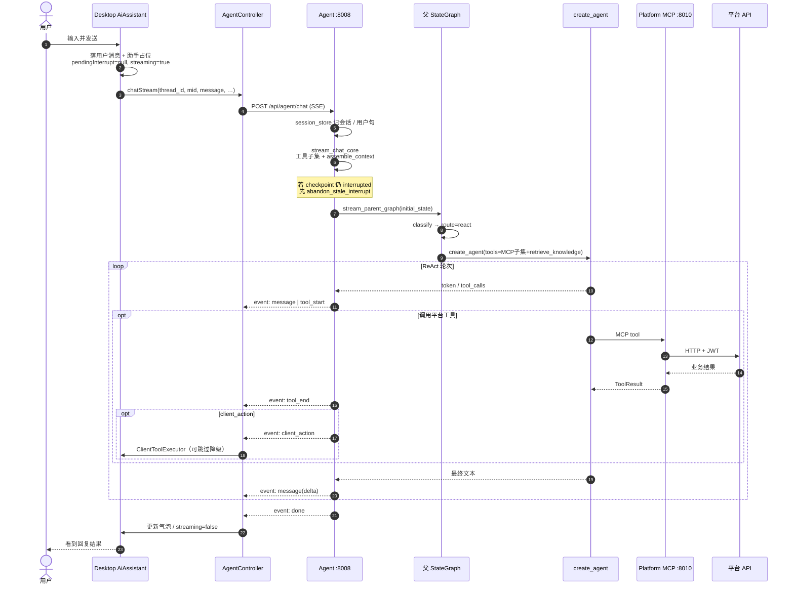
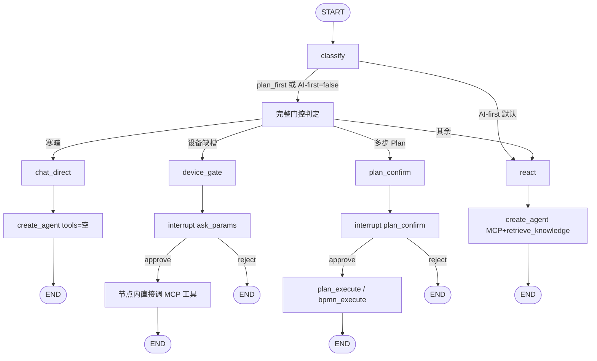
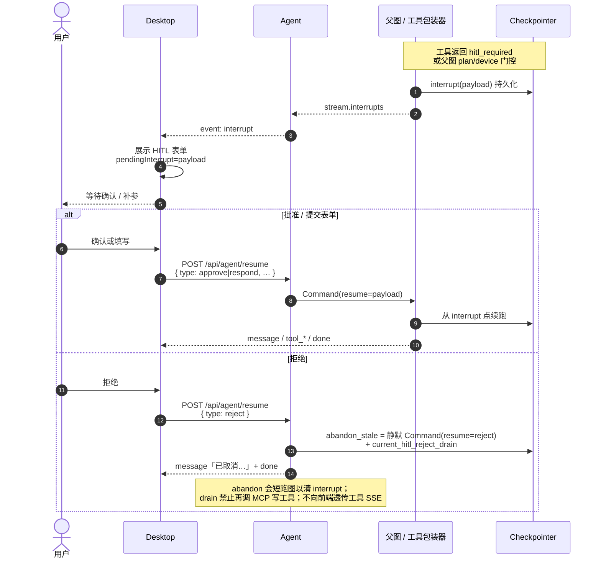
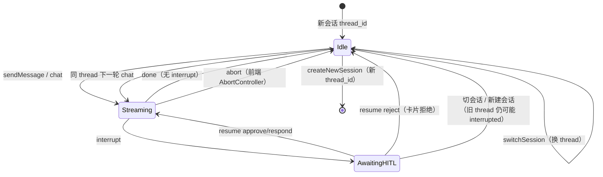

# 07 — 对话端到端流程（用户需求 → 回复 / 多轮）

> 本文描述桌面端用户从**提出需求**到**看到回复**，以及**多轮会话 / HITL / 拒绝 / 中止 / 新会话**的完整链路。  
> 运行时细节见 [`03-agent-runtime.md`](./03-agent-runtime.md)；SSE / ToolResult 契约见 [`06-contracts.md`](./06-contracts.md)。

## 1. 一句话总览

```text
用户输入
  → Desktop Store 落用户气泡 + 助手占位
  → POST /api/agent/chat（SSE）
  → stream_chat → assemble_context（RAG / Playbook）
  → 父 StateGraph（默认 AI-first：classify → react → create_agent）
  → 可选：MCP 工具 → 平台 API / client_action
  → 可选：interrupt → 前端 HITL → POST /api/agent/resume → Command(resume)
  → SSE message / tool_* / plan / interrupt / done
  → Desktop 渲染终态；同 thread 下一轮复用 checkpointer
```

**标识符**：

| 字段         | 含义                                                        |
| ------------ | ----------------------------------------------------------- |
| `thread_id`  | 会话 ID；checkpointer / 侧栏会话 / 工具子集记忆的主键       |
| `mid`        | 本轮用户需求 ID；用户气泡与助手气泡、SSE interrupt 归属对齐 |
| `run_mode`   | `readonly` / `confirm` / `autonomous`；影响工具子集与写确认 |
| `plan_first` | 显式「先计划」；覆盖 AI-first 旁路，走 plan_confirm 门控    |

---

## 2. 主路径时序（无 HITL）

默认 `AGENT_INTENT_AI_FIRST=true`：classify **恒路由 `react`**。



### 2.1 桌面端落点

| 步骤     | 位置                                                                   |
| -------- | ---------------------------------------------------------------------- |
| 发送入口 | `MessageInput` → `useAgentStream.sendMessage`                          |
| 本地占位 | Store：`messages` + `setStreaming(true)`；清 `pendingInterrupt`        |
| HTTP/SSE | `AgentController.chatStream` → `consumeSseResponse` / `sseParser`      |
| 事件写回 | `createStreamHandlers`：text / tool / plan / interrupt / client_action |
| 流结束   | `finalizeAssistantMessage`；空回复兜底 `aiAssistant.emptyResponse`     |

### 2.2 Agent 落点

| 步骤      | 位置                                                                                                          |
| --------- | ------------------------------------------------------------------------------------------------------------- |
| HTTP 入口 | `app/api/chat.py` → `chat_sse` → `stream_chat`                                                                |
| 用例      | `app/application/conversation/chat.py` → `stream_chat_core`                                                   |
| 上下文    | `assemble_context`：被动 RAG、Playbook、近期句、意图注记 → `llm_user_message`；纯设备控制意图**跳过**被动 RAG |
| 流        | `stream_parent_graph` → `astream_events(v3)` → `iter_agent_sse_events_async`                                  |
| 包装      | `wrap_stream_with_plan_trace`（plan / trace / audit）                                                         |

---

## 3. 父图路由（与回复产生方式）



| 开关 / 请求             | 行为                                                                                                  |
| ----------------------- | ----------------------------------------------------------------------------------------------------- |
| AI-first `true`（默认） | classify 恒 `react`；缺参/确认主要靠工具包装器 `interrupt`                                            |
| `plan_first=true`       | 覆盖 AI-first 旁路，走完整门控；**可能**命中 `plan_confirm` / `device_gate` / `chat_direct` / `react` |
| AI-first `false`        | 同上完整门控（寒暄短路、设备缺槽、多步确认）                                                          |

> **device_gate**（当前实现）：缺槽 `interrupt` 批准后在**本节点内**调用 MCP 工具并 `route=end`，**不再**进入 `react`。

工具调用链（react 内）：

```text
create_agent
  → 包装后的 MCP tool（Auth / HITL / run_mode / hooks）
  → MultiServerMCPClient → Platform MCP :8010/mcp
  → 平台 API（JWT）→ 业务结果 ToolResult
  → 可选 client_action(s) → SSE → 桌面 ClientToolExecutor
```

达梦：**智能化侧仅 SELECT**；业务写只经平台 API（见 [`09`](./09-platform-db-readonly.md)）。

---

## 4. HITL：中断 → 确认/补参 → 续跑

HITL **唯一**机制：图内 `interrupt(payload)` + `POST /api/agent/resume` → `Command(resume=…)` + checkpointer。  
**禁止**图外 `pending_plan` / `pending_tool_hitl`。



| 路径               | 桌面入口                                   | 后端                                                                                              |
| ------------------ | ------------------------------------------ | ------------------------------------------------------------------------------------------------- |
| 补参 / 表单提交    | `submitHitlResume`                         | `stream_resume` → `Command(resume=…)`                                                             |
| 一键确认           | `submitHitlConfirm(true)`                  | 同上；可设 `current_hitl_confirm_bypass`                                                          |
| 拒绝               | `submitHitlConfirm(false)` → `type=reject` | `abandon_stale_checkpoint_interrupt`（静默 reject 续跑清 checkpoint）+ 取消文案；**不**走业务续跑 |
| interrupt 事件来源 | Store `pendingInterrupt`                   | 流内 `stream.interrupts`；chat 结束还可从 checkpoint **补发**                                     |

自定义表单 payload 形状：`ask_params` / `confirm` / `plan_confirm` 等，经 `interrupt(payload)` 下发（契约见 `06`）。

---

## 5. 多轮会话状态机



### 5.1 同 thread 下一轮新消息

1. 桌面：`beginThreadController` 会 abort **同 thread** 上一条未结束的 SSE；追加新 `mid` 的用户/助手气泡；若上一助手仍有活跃 HITL / running tool / streaming → `finalizeTurnResidue(…, "superseded")`。
2. 后端 `stream_chat_core`：
   - `clear_thread_orchestration`
   - 若 `parent_has_pending_interrupt` → **`abandon_stale_checkpoint_interrupt`**（静默 `Command(resume=reject)` + `current_hitl_reject_drain`，避免 LLM 重试写工具）
   - `repair_dangling_tool_calls`
   - 从 checkpoint + 近期句提取 device/alarm focus；重新选工具子集并 `remember_thread_tool_subset`
3. `assemble_context`：被动 RAG + Playbook 注入 `llm_user_message`（**纯设备控制意图跳过被动 RAG**）；新 `HumanMessage(id=mid)` 进入同一 checkpointer thread。

### 5.2 HITL 等待中的用户出口（重要）

`ChatPanel` 在 `hasPendingHitl`（`pendingInterrupt` 或活跃 interrupt 块）时 **禁用输入框**，不能直接打字 supersede。

| 出口            | 行为                                                                                       |
| --------------- | ------------------------------------------------------------------------------------------ |
| 卡片确认 / 补参 | `submitHitlConfirm(true)` / `submitHitlResume` → `/resume` 续跑                            |
| 卡片拒绝        | `submitHitlConfirm(false)` → `/resume` `type=reject` → 静默 abandon + 取消文案             |
| 切会话 / 新建   | 离开当前 UI；**旧 thread checkpoint 可能仍 interrupted**；回来可继续或下次 chat 时 abandon |
| 流式中点停止    | 仅 `abort`（见下）；若已进入 AwaitingHITL，通常走卡片拒绝                                  |

后端「新 chat 先 abandon 旧 interrupt」仍成立，但产品主路径是 **卡片 resolve**，不是输入框打断。

### 5.3 abort（停止生成）

- 桌面：`abortStream` → `AbortController.abort()` 断开 SSE；`finalizeTurnResidue(…, "aborted")`。
- **无**独立后端 abort API；**不**调用 `/resume` reject；服务端随连接断开结束当前 `astream`。
- checkpoint **可能仍带 interrupt**：下一次同 thread `chat` 会 abandon。

### 5.4 新会话 / 切换会话 / 历史恢复

| 操作               | 行为                                                                                |
| ------------------ | ----------------------------------------------------------------------------------- |
| `createNewSession` | 新 `thread_id`；旧会话快照进 `threadSnapshots`；新会话空消息、无 pending            |
| `switchSession`    | 切 `currentThreadId`；有快照或后台流则跳过拉历史；否则 `loadThreadHistory`          |
| 拉历史             | `GET /api/agent/threads/{id}/state` → 投影 messages + `pending_interrupt` 恢复 HITL |
| 删除会话           | `disposeThreadRuntime` 中止该 thread 流 + 清快照；后端清理持久化                    |

切走不打断后台 SSE（`runWithMessageThread` + `streamingByThread`）；完成后可通知点回。  
**新会话 = 新 `thread_id`**，与 checkpointer 隔离。

### 5.5 resume 与 chat 的工具子集

- chat：按本轮意图选子集并写入内存 + `agent_thread_tool_subset`（Postgres）。
- resume：`get_remembered_thread_tool_subset(thread_id)`，绑定与触发 HITL 时同一父图工具集；**不再 classify**。

---

## 6. SSE 事件与 UI 映射

权威契约：[`06-contracts.md`](./06-contracts.md)。桌面只认下列事件名：

| SSE 事件                          | UI 效果                                      |
| --------------------------------- | -------------------------------------------- |
| `message`                         | 助手文本增量                                 |
| `tool_start` / `tool_end`         | 工具卡片状态 / 结果摘要                      |
| `plan` / `plan_update` / `replan` | Plan 步骤条（M1 无 BPMN 画布）               |
| `interrupt`                       | HITL 表单 + `pendingInterrupt`               |
| `client_action`                   | `ClientToolExecutor`；无宿主则跳过并降级提示 |
| `trace`                           | 调试轨迹（可选展示）                         |
| `done` / `error`                  | 结束流 / 错误文案                            |

```text
astream_events(v3)
  → agent_stream_adapter / parent_graph_stream
  → wrap_stream_with_plan_trace
  → FastAPI text/event-stream
  → AgentController.consumeSseResponse
  → useAgentStream handlers → Store.messages
```

---

## 7. 关键源文件索引

### 桌面端

| 职责                  | 路径                                                               |
| --------------------- | ------------------------------------------------------------------ |
| 主壳 / 面板 / 侧栏    | `DesktopChatApp.tsx` / `ChatPanel.tsx` / `SessionSidebar.tsx`      |
| 发送 / resume / abort | `hooks/useAgentStream.ts`                                          |
| Store / 会话          | `store.ts`（路径均在 `apps/desktop/src/components/AiAssistant/`）  |
| SSE Client            | `apps/desktop/src/services/AgentController.ts`                     |
| SSE 解析              | `utils/sseParser.ts`                                               |
| HITL 工具函数         | `utils/hitlInterruptUtils.ts`                                      |
| 历史投影              | `utils/mapHistoryMessages.ts`                                      |
| Client Tool           | `ClientToolExecutor.ts`                                            |
| 消息列表 / 输入 / 卡  | `MessageList.tsx` / `MessageInput.tsx` / `HitlInteractionCard.tsx` |

### Agent

| 职责                | 路径                                                          |
| ------------------- | ------------------------------------------------------------- |
| chat / resume HTTP  | `app/api/chat.py`、`app/api/resume.py`；路由挂 `app/main.py`  |
| 用例                | `app/application/conversation/chat.py`、`resume.py`           |
| 父图 / create_agent | `app/graph/parent_graph.py`、`agent_factory.py`               |
| 流适配              | `app/graph/parent_graph_stream.py`、`agent_stream_adapter.py` |
| envelope            | `app/graph/stream_envelope.py`                                |
| 上下文 / RAG 注入   | `app/graph/context.py`、`app/services/prompt_assembly.py`     |
| interrupt 统一入口  | `app/graph/hitl_interrupt.py`                                 |
| checkpoint HITL     | `app/graph/checkpoint_utils.py`                               |
| MCP Client 包装     | `app/mcp/client.py`（`hitl_required` → 包装器内 interrupt）   |

### 契约

| 职责     | 路径                                         |
| -------- | -------------------------------------------- |
| SSE 类型 | `packages/shared-types`                      |
| catalog  | `packages/agent-core/tool-catalog.ts`        |
| Python   | `services/platform-contracts`（`contracts`） |

---

## 8. 对称路径自检清单

改对话主链时至少 mentally walkthrough：

- [ ] **chat**：新消息 happy path（纯文本 / 带工具）
- [ ] **resume**：approve / respond 续跑到 done
- [ ] **reject**：取消文案 + checkpoint interrupt 已清
- [ ] **abort**：前端停止；同 thread 下一轮 chat 无残留卡死
- [ ] **HITL 等待**：输入禁用；卡片 approve/reject；切会话后再 chat 不卡死
- [ ] **新会话**：新 `thread_id`，不串话旧 checkpoint
- [ ] **切会话**：快照 / `threads/{id}/state` 历史恢复后 `pendingInterrupt` 仍可续跑

手工验收对照：[`../desktop-m1-acceptance.md`](../desktop-m1-acceptance.md)。
