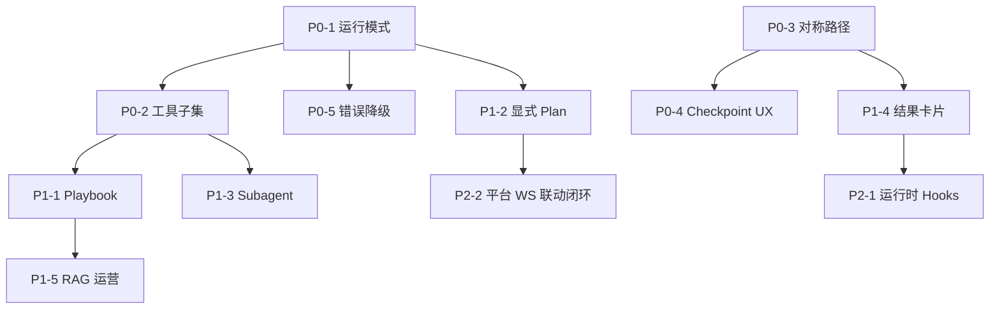

# Cursor Agent 对标分析与优化计划

> **文档性质**：迭代设想与对标分析，**不是**编码唯一依据。架构实现仍以 [`../architecture/`](../architecture/) 为准。  
> **目标**：借鉴 Cursor Agent Harness 的可靠智能设计，提升本仓（ims-ai-desktop）Agent 产品能力，**不**复刻 IDE 写代码能力。  
> **基线**：Desktop M1（聊天 + Plan 步骤条 + HITL）；验收见 [`../desktop-m1-acceptance.md`](../desktop-m1-acceptance.md)。  
> **撰写依据**：Cursor 公开文档（[Agent overview](https://cursor.com/docs/agent/overview)、Rules / Skills / Hooks / MCP / Subagents）+ 本仓 `docs/architecture/*`。

---

## 1. Cursor Agent 技术实现摘要

### 1.1 三要素（官方模型）

| 层               | 含义               | 典型内容                                    |
| ---------------- | ------------------ | ------------------------------------------- |
| **Instructions** | 行为约束与领域知识 | System prompt、Rules、`AGENTS.md`、用户偏好 |
| **Tools**        | 与外部世界交互     | 读写文件、Shell、Browser、Web、MCP          |
| **Model**        | 推理与工具选型     | 用户选定或 Auto 路由                        |

本质是 **Agent Harness（编排壳）**：模型决策，**工具在客户端/宿主确定性执行**，结果回灌后再决策——标准 tool-calling / ReAct 循环。

### 1.2 六层控制系统

| 层                    | 机制                                | 解决的问题                        |
| --------------------- | ----------------------------------- | --------------------------------- |
| 1 Context Engineering | Rules / Team Rules / `AGENTS.md`    | 短、硬约束常驻，防反复踩坑        |
| 2 Dynamic Knowledge   | Skills（按需）+ MCP + 代码索引      | 长流程与外部能力不占满 context    |
| 3 Mode / Permission   | Agent / Ask / Plan / Debug          | 用模式控制能力边界与流程          |
| 4 Tool Loop           | 搜 → 读 → 改 → 跑 → 验证            | 自主完成任务的主循环              |
| 5 Lifecycle Hooks     | beforeSubmit / preTool / afterEdit… | 审批、审计、格式化、拦截危险操作  |
| 6 Subagents           | Explore / Shell / Browser 等        | 重 context 任务隔离，摘要回主对话 |

### 1.3 用户需求处理流程（产品可见）

```text
用户输入 + 模式
  → 组装 Instructions（Rules / Skills / 会话上下文）
  → Hooks（beforeSubmit）
  → 模型推理：选工具 / 填参 / 或追问
  → Run Mode / 沙箱 / 审批
  → 执行 Tools / MCP / Subagent
  → 结果回灌 → 继续循环
  → 流式回复 + Checkpoint
  → afterResponse / stop Hooks
```

**模式差异**：

| 模式  | 行为                                              |
| ----- | ------------------------------------------------- |
| Agent | 可改文件、跑命令，完整工具循环                    |
| Ask   | 只读探索，不改文件                                |
| Plan  | 先研究与澄清 → 可编辑计划 → 用户 Build 后才写代码 |
| Debug | 先假设与运行时证据，再定点修复                    |

### 1.4 关键设计原则（可迁移）

1. **Instructions / Tools / Model 分离** —— 换模型不换架构
2. **工具确定性执行，模型只选型与填参** —— MCP 即为此
3. **短 Rules 常驻，长 Skills/文档按需加载** —— 控 context
4. **模式 = 权限 + 流程**，不是换一套编排引擎
5. **状态生命周期闭合** —— pending / streaming / interrupt 必须有 clear / finalize
6. **子任务隔离 context** —— 探索类工作不污染主对话

---

## 2. 本仓现状（对照基线）

### 2.1 已具备的同构能力（强项）

| Cursor 概念         | 本仓落点                                                              | 成熟度      |
| ------------------- | --------------------------------------------------------------------- | ----------- |
| Harness + Tool Loop | 父 `StateGraph` + 节点内 `create_agent`                               | ✅ M1       |
| Tools 单一执行面    | Platform MCP `:8010`；禁止业务 `@tool` 旁路                           | ✅          |
| 对话流协议          | FastAPI SSE `:8008`（与 MCP 分离）                                    | ✅          |
| HITL                | `interrupt` + `Command(resume)` + checkpointer                        | ✅          |
| 持久化              | `AsyncPostgresSaver` + `thread_id`                                    | ✅          |
| 知识增强            | Qdrant RAG + `retrieve_knowledge`                                     | ✅          |
| 契约单一源          | TS `packages/*` + Python `services/platform-contracts`（`contracts`） | ✅          |
| 工具执行边界        | MCP `runtime/tools`；Agent 禁止 `import platform_mcp`                 | ✅          |
| 质量门禁            | 对称路径、达梦只读、影响面清单                                        | ✅ 工程侧   |
| 对外 MCP            | Agent Gateway `/mcp`                                                  | ✅          |
| 开发态 Cursor 定制  | `.cursor/rules` / skills / hooks / mcp.json                           | ✅ 开发体验 |

### 2.2 产品定位差异（不要照搬）

| 维度          | Cursor                   | ims-ai-desktop                                   |
| ------------- | ------------------------ | ------------------------------------------------ |
| 用户          | 开发者                   | 平台运维 / 值班 / 业务用户                       |
| 主任务        | 读写代码、跑终端、改仓库 | 告警查询、设备操作、知识问答、页面跳转           |
| 危险面        | Shell / 任意文件写       | 平台写操作（经平台 API）、误操作设备             |
| UI            | IDE Agent 面板           | Electron AiAssistant（M1 无 BPMN 画布）          |
| Client Action | Browser / 编辑器         | `client_action`（navigate 等；无宿主可跳过降级） |

**结论**：对标的是 **可靠智能的 Agent 产品形态与工程方法**，不是 Cursor 的「AI 程序员」能力集。

---

## 3. 架构与实现差异对照

### 3.1 总览矩阵

> **说明**：下表为 **2026-08-05** 对照代码后的现状；已落地项不再标「高差距」。未勾满的体验缺口见 §7 脚注。

| 能力域        | Cursor                          | 本仓现状                                                             | 差距等级   | 说明                                                                          |
| ------------- | ------------------------------- | -------------------------------------------------------------------- | ---------- | ----------------------------------------------------------------------------- |
| 编排内核      | 闭源 Harness + tool loop        | LangGraph 父图 + `create_agent`                                      | 低         | 路径正确，需打磨可靠性                                                        |
| 工具面        | 内置 IDE tools + MCP            | **仅** Platform MCP + RAG 工具                                       | 低（设计） | 业务侧应保持单一 MCP                                                          |
| Instructions  | Rules 分层 + 智能应用           | System/节点 prompt + RAG + **运行时 Playbook**                       | 低～中     | Playbook 已落地；缺用户可编辑 Rules                                           |
| Skills        | 按需加载多步骤工作流            | 运行时 Playbook（alarm-dispose / batch-export 等）按意图注入         | 低～中     | **可做**语义检索 + 自动评测（§3.2）；现为关键词匹配                           |
| 模式系统      | Agent/Ask/Plan/Debug            | 会话 `run_mode`：readonly / confirm / autonomous + `plan_first` 开关 | 低～中     | 非 Cursor 同名四模式；语义对齐权限边界                                        |
| Context 管理  | 索引 + 按需读 + Skills 渐进披露 | **domains 子集 / safe_default（非写）**；写工具仅领域命中；RAG 注入  | 中         | 可有限度优化召回（§3.2）；多域并集优先不漏条件句；禁堆词 NLU                  |
| HITL / 审批   | Run Mode + Hooks + 确认         | interrupt 表单 + run_mode + preflight；对称路径已硬化                | 低         | **可做**统一 confirm + **平台可配风险等级**（§3.2）                           |
| Subagents     | Explore/Shell 等隔离            | 知识检索 Subagent（`retrieve_knowledge` 摘要回主）                   | 中         | 仅工具路径；被动 RAG 仍注入主对话                                             |
| Checkpoint UX | 对话时间线可回滚文件            | checkpointer resume + HITL 终态/可续跑文案                           | 低～中     | 无 IDE 级文件回滚                                                             |
| 可观测性      | Trace/工具卡片较成熟            | SSE tool 事件 + 结构化结果卡 + Audit/Hooks                           | 中         | **必须做** LangSmith 级仪表盘（运维+流程评估+效率，§3.2）；Workspace 侧栏可做 |
| 并行 Agent    | Cloud / 多 Agent Window         | 多会话切片：切走不 abort + notification                              | 低（M1）   | **可做**关窗续跑 / 任务队列（§3.2）                                           |
| Hooks 运行时  | 生命周期脚本可拦可改            | 工具前后 Hooks（deny_list + audit）                                  | 中         | 非全生命周期 beforeSubmit 等                                                  |
| 模型路由      | Auto / 按任务复杂度路由         | Auto + 关键词启发式 light/default                                    | 低～中     | 基线已上线；**升级待评估**（意图准不准 + 是否更快，§3.2）                     |
| client_action | Browser 工具闭环                | 宿主桥 + 回执仅 audit（过渡）→ WS + **图内回灌**（§3.2）             | 中         | **可做**：真闭环回灌图；传输走平台 WS                                         |
| BPMN UI       | —                               | **未纳入**；前端 stub                                                | —          | 单独立项                                                                      |

差距等级：**高** = 对「像 Cursor 一样可靠智能」影响大；**中** = 体验与稳健性；**低** = 可后置或已基本对齐。

### 3.2 架构层差异（设计）

```text
Cursor:
  Instructions(分层) + Mode(权限) + Tools(内置|MCP) + Subagents
       ↑ Hooks 贯穿
  Context: 索引 + 按需 Skills + 工具 schema 渐进

本仓（2026-08 后）:
  父图(classify→…) + create_agent(domains 子集 | safe_default) + RAG + Playbook
       ↑ HITL 仅 interrupt；run_mode / plan_first 门控
  Context: 写工具按领域进入；闲聊默认非写子集；thread 子集可 Postgres 持久化
```

**仍存设计债（非「未做」）**：

1. **AI-first 默认**弱化「先出可编辑计划」；已用 `plan_first` 补齐「先确认再执行」。**产品决策（2026-08-06）：不做可编辑 Plan→Build**——平台用户只提目标、不关心执行步骤；步骤条仅过程可视化（可看/可中止）。与 Cursor Plan Mode 的差距接受为产品定位差异，非待办。
2. **领域 / 工具子集（可优化，须控制度；产品决策 2026-08-06）**：
   - **可做**：在现有 `select_tool_subset`（关键词推断 domains → 绑工具）上做有限度改进，减少漏绑导致「想查查不了 / 想写写不了」。
   - **控制度**：不得恢复「正则决定 chat/plan/device/react」的意图路由；不得无限堆触发词做成第二套 NLU。关键词/规则只服务**工具绑定**，不替代大模型做条件判断与步骤编排。
   - **不漏重点**：多意图/条件句须**多域并集**（例：「若最近三天有告警则开门」→ `alarm`∪`device`，查告警与开门工具同时可绑）；优化时优先召回用户需求中的查询条件与关键动作，宁可略宽不可漏域。偏窄导致模型无法先查再写，视为回归。
   - **仍由模型负责**：先查后写、有数据才下发等逻辑；写操作继续靠 `run_mode` + HITL。
3. **Playbook 匹配仍偏关键词（可增强；产品决策 2026-08-06）**：
   - **可做**：① **语义检索**——将 playbook 索引/正文向量化，按用户话术召回相关规程注入（Embedding + 向量库；注入后仍由对话大模型按规程执行）；② **自动评测**——固定测试句断言工具调用序列/关键步骤，补齐「仓内无自动评测、仅靠联调观测」缺口。
   - **约束**：短索引 + 按需全文；限制单轮注入份数；不把 Playbook 做成第二套意图路由器，也不替代 AI-first / HITL。
4. **业务工具扩面（方向可做；形态待讨论；产品决策 2026-08-06）**：
   - **可做**：覆盖值班 / 门禁 / 配置等高频平台能力（对照 `prj-docs` / YApi），补 catalog、HITL、结果卡与 i18n。
   - **待讨论（未拍板不编码）**：新能力走 **Platform MCP**（既有 SOP：catalog → export → MCP handler → 平台 API）还是 Agent 内 **本地 tool**（LangChain `@tool`）。
   - **现状基线（讨论默认参照，非最终结论）**：架构红线为业务工具 **仅** Platform MCP；Agent 仅本地 `retrieve_knowledge` 等非业务工具；**禁止** `import platform_mcp`、禁止业务 `@tool` 与 MCP 双轨；达梦只读、业务写走平台 API。
   - **拍板前**：不新增值班/门禁/配置等业务执行面；讨论须写明选型理由与对 HITL / 契约 / 桌面卡片的影响。
5. **平台联动 + client_action 图内回灌（可做；产品决策 2026-08-06）**：
   - **传输换方案**：不以桌面 Electron 宿主桥 mock / 仅 audit 为最终闭环；目标为平台侧 **WebSocket** 接收智能平台流程，需参与时调**平台侧工具**，结果回传智能平台。
   - **图内回灌（真闭环）可做**：`client_action`（及平台回执）执行结果必须进入 Agent 图（如 ToolMessage / `Command(resume)` 等价路径），使模型能根据成功/失败继续决策；**禁止**长期以「回执只写 audit、不回灌图」为终态。
   - **过渡**：现有宿主桥 + `client_action_result` audit、无宿主 skip 降级可保留为过渡/降级。
   - **待共建**：WS 协议、鉴权、与 HITL/`client_action` 契约及图内回灌字段对齐；实施前补架构小节与验收项。
6. **BPMN 编排 UI** 明确非目标；后端若残留 API 勿误判为已有画布。
7. **模型路由升级（待评估；产品决策 2026-08-06）**：
   - **现状**：P2-3 基线已上线（Auto + 关键词启发式 light/default）。
   - **升级不默认开工**：复杂度/代价感知等增强须先评估，**评估未通过则不做**。
   - **评估焦点**：① 是否真正提高意图/任务分流准确（误路由到小模型导致工具链失败，或误用大模型浪费成本）；② 是否保证快速响应（路由决策本身延迟、小模型在多步工具场景是否更慢/更多轮）。
   - **说明**：模型路由主要影响「用哪颗模型干活」，与领域工具子集/意图识别不是同一层；不得假设「换路由必提意图准确」。
8. **写工具统一强制 confirm（可做；风险须可配置；产品决策 2026-08-06）**：
   - **可做**：Agent 包装层按风险统一门控——`confirm`（及约定模式）下高风险/写类工具必经 `ask_user_confirm` → interrupt，减少 handler 漏标。
   - **平台前提**：平台侧提供工具**是否高风险 / 风险等级**的配置能力，支持用户（或运营）配置，**禁止**仅依赖代码/catalog 写死为唯一来源。
   - **落点约束**：catalog 可保留默认 `risk_level`；运行时以平台配置（可覆盖默认）为准；配置变更后 HITL 行为须一致可测；仍不引入图外 `pending_*` HITL。
9. **工具 schema 两段式（可做；产品决策 2026-08-06）**：
   - **可做**：第一段仅注入工具名 + 短描述；模型选定目标工具后，第二段再注入完整参数 JSON Schema，再实际调用 MCP，以降低上下文 token。
   - **约束**：与现有 `select_tool_subset` / thread 指纹 / resume 同一父图工具集兼容；关键路径不得因摘要过粗漏工具；仍由大模型选工具与填参，不引入正则意图路由。
10. **多会话 / 关窗续跑 / 任务队列（可做；产品决策 2026-08-06）**：
    - **可做**：在 P2-4 最小切片（切会话不 abort + notification）之上，支持关窗后服务端继续、任务队列、重开查看结果。
    - **约束**：线程/任务状态持久化；abort/resume/新会话对称路径闭合；不做无关的 Cloud 多 Agent 农场。
11. **可观测仪表盘（必须做；产品决策 2026-08-06）**：
    - **必须做**（非可选）：对标 LangSmith——支撑运维排障；评估需求功能的执行流程是否合理；监控各流程执行效率（延迟、工具链、HITL、成败率等）。
    - **范围**：至少覆盖父图节点 / 工具调用 / SSE 回合 / 错误与降级的可追溯 trace；具体用自建仪表盘或对接 LangSmith 等，实施时选型。
    - **约束**：观测数据落 Agent 侧存储/导出即可；不因此改写 HITL 主链。
12. **语音 ASR / 声纹增强（可做；产品决策 2026-08-06）**：
    - **可做**：按架构 `10-voice-asr` / `11-voiceprint` 继续产品化（纠错可视化、门禁、录入核验等）。
    - **说明**：ASR/声纹为专用模型链路；转入对话后的理解与工具调用仍走主 Agent。

### 3.3 实现层差异（工程）

| 主题        | Cursor 侧（公开行为） | 本仓实现                                                | 后续可选项                                                      |
| ----------- | --------------------- | ------------------------------------------------------- | --------------------------------------------------------------- |
| 工具发现    | MCP schema 按需       | `select_tool_subset`：domain / safe_default；指纹持久化 | 有限度召回优化；**可做**两段式 schema（§3.2）；**禁**堆词表 NLU |
| 确认门控    | Run Mode allowlist    | `run_mode` + preflight + `ask_user_confirm`             | **可做**：统一强制 confirm + **平台可配风险等级**（§3.2）       |
| 计划        | Plan Mode + Build     | `plan_first` → `plan_confirm`；预览只读                 | **Won’t do** 可编辑 Plan→Build（见 §3.2）                       |
| 失败恢复    | Checkpoint / 重试     | resume/reject/abort + 残留态清理                        | 持续按 M1 验收回归                                              |
| 文档优先    | MCP docs / Skills     | 开发强制 docs-langchain；运行时 Playbook                | **可做**：Playbook 语义检索 + 自动评测（§3.2）                  |
| 审计        | Hooks / 日志          | 运行时 tool Hooks + AuditLog                            | 默认打开 after 审计                                             |
| Client 执行 | Browser 工具闭环      | 宿主桥 + `client_action_result` 审计（过渡）            | **可做**：WS 传输 + **图内回灌真闭环**（§3.2）                  |

### 3.4 本仓已对齐、必须守住的红线

- 禁止图外 `pending_*` HITL、禁止 ReAct 双轨
- 禁止 Platform MCP 旁路业务 `@tool`；Agent **禁止** `import platform_mcp`
- 共享逻辑只依赖 `contracts`（目录 `services/platform-contracts`）
- 平台达梦仅 `SELECT`；业务写只经平台 API
- SSE 与 MCP 职责分离（MCP 不替代聊天流）
- M1 不引入 BPMN 编排画布

后续优化 **必须落在父图 / MCP / checkpointer / SSE 主链内**，与 [`ai-dev-quality-gates`](../../.cursor/rules/ai-dev-quality-gates.mdc) 一致。

---

## 4. 目标产品画像（对标后的「可靠智能」）

面向平台用户，Agent 应达到：

1. **可预期**：用户知道当前是只读、确认后执行、还是自主执行
2. **可控**：高风险写操作必经 HITL；reject/abort 后无残留 loading/Plan/interrupt
3. **省上下文**：工具与知识按需进入模型，长流程有 playbook
4. **可观察**：工具步骤、计划、中断原因、审计可回看
5. **可恢复**：同 thread 可 resume；新意图正确清理旧 interrupt
6. **可扩展**：新工具只走 catalog → export → MCP → preflight → i18n

**非目标**：IDE 级任意 Shell/改文件、Cloud 多 Agent 农场、BPMN 画布（除非单独立项）。

---

## 5. 后续优化计划

按「先可靠性与 context，再体验，再规模化」排序。每项标注建议落点与验收要点。

### 阶段 P0 — 可靠性基座（建议 1～2 个迭代）

> 目标：行为像「可控的 Cursor Agent」，而不是「偶尔聪明的聊天框」。

| ID   | 事项                                       | 落点                                                                  | 为何                             | 验收要点                                                       |
| ---- | ------------------------------------------ | --------------------------------------------------------------------- | -------------------------------- | -------------------------------------------------------------- |
| P0-1 | **会话运行模式**（只读 / 确认执行 / 自主） | 桌面端会话设置 + Agent 请求字段 + 工具包装器/preflight                | 对齐 Cursor Mode：权限即产品     | 只读下拒绝写类工具或强制降级提示；确认模式下写操作必 interrupt |
| P0-2 | **工具子集注入**                           | catalog 风险/领域标签 → `create_agent` 绑定时过滤或两段式（先选后详） | 对齐 context 渐进披露            | 工具数增长后 token/延迟可测下降；关键路径不丢工具              |
| P0-3 | **对称路径硬化**                           | chat / resume / reject / abort / 新消息                               | Cursor Checkpoint 思维：状态闭合 | 按 M1 验收 + 专门「残留态」用例：无旧 Plan/HITL/loading        |
| P0-4 | **HITL/Checkpoint UX**                     | 桌面：明确「等待确认 / 可续跑 / 已拒绝」                              | 用户理解中断与恢复               | 刷新或重进会话仍能正确展示 interrupt 态                        |
| P0-5 | **错误与降级话术统一**                     | SSE `error` + i18n + MCP 不可达策略                                   | 可靠感来自失败可解释             | MCP 挂时明确提示且不静默空转                                   |

### 阶段 P1 — 智能与流程（建议 2～3 个迭代）

> 目标：复杂任务不靠「临场发挥」，而靠可加载的工作流 + 更好的计划/检索。

| ID   | 事项                               | 落点                                                         | 为何                                 | 验收要点                                             |
| ---- | ---------------------------------- | ------------------------------------------------------------ | ------------------------------------ | ---------------------------------------------------- |
| P1-1 | **运行时 Playbook（Skills 等价）** | 知识库分片或 Agent 侧 playbook 目录；按意图检索注入          | 对齐 Cursor Skills                   | 「告警处置 / 批量导出」等多步任务步骤稳定可复现      |
| P1-2 | **显式 Plan 体验开关**             | UI 开关或非 AI-first 路径产品化；保留 interrupt plan_confirm | 对齐 Plan Mode                       | 用户可要求「先出计划再执行」；Build/确认后才调写工具 |
| P1-3 | **轻量 Subagent / 子任务**         | 父图并行节点或专用检索子调用，摘要回主 agent                 | 对齐 Subagents                       | 长检索不污染主对话；主回复仍连贯                     |
| P1-4 | **结构化工具结果卡片**             | 桌面高频工具卡片（告警表、设备列表等）                       | roadmap 已列；对齐 Cursor 工具可视化 | 关键工具结果可读、可点选进入 HITL                    |
| P1-5 | **RAG 可运营化**                   | 知识增删改查、同步可观测                                     | 智能依赖知识质量                     | 运营可更新 playbook/规程而不改代码                   |

### 阶段 P2 — 产品化与规模（后续）

| ID   | 事项                                 | 落点                                                   | 说明                                                              |
| ---- | ------------------------------------ | ------------------------------------------------------ | ----------------------------------------------------------------- |
| P2-1 | 运行时 Hooks（审计/拦截）            | 工具调用前后钩子 → Audit + 策略引擎                    | 对齐 Cursor Hooks；不替代 interrupt                               |
| P2-2 | 平台 WS 联动闭环（取代纯宿主桥闭环） | 平台 WS 收智能平台流程 → 平台工具执行 → 结果回灌 Agent | **可做（2026-08-06 换方案）**；宿主桥 audit 仅过渡                |
| P2-3 | 模型路由（成本/质量）升级            | 复杂度/代价感知选小/大模型（相对现关键词 Auto）        | **待评估（2026-08-06）**：意图准不准 + 响应是否更快；未通过则不做 |
| P2-4 | 多会话 / 关窗续跑 / 任务队列         | 桌面 thread 缓存 + 服务端队列/持久化 + 重开续看        | **可做（2026-08-06）**；最小切片已落地，本项为增强                |
| P2-5 | BPMN 编排 UI                         | 单独立项                                               | **不在**本对标默认范围                                            |

---

## 6. 建议实施顺序（依赖关系）



**原则**：先 P0（可控、不炸 context、状态不脏），再 P1（更聪明），最后 P2（规模与联动）。

---

## 7. 每阶段「像 Cursor」的成功标准

### P0 Done

- [x] 用户可切换只读 / 确认 / 自主，且后端强制生效（P0-1）
- [x] 默认绑定工具为子集或分级；全量工具不再是唯一策略（P0-2：domain 命中子集；未命中 **safe_default=非写**；thread 子集 Postgres 持久化供 resume）
- [x] reject / abort / 新消息后无 HITL、Plan、loading 残留（P0-3）
- [x] interrupt 态在 UI 可解释、可续跑（P0-4；P0-5 含 MCP 不可达话术）

### P1 Done

- [x] 至少 2 个高频场景有可版本化 playbook（P1-1：`alarm-dispose` / `batch-export`；关键词注入已落地）
- [ ] Playbook **语义检索**（**可做**，Embedding + 限份注入；见 §3.2）
- [x] Playbook **自动评测**（固定用例断言匹配/工具子集；`eval/playbook_cases.json` + `scripts/eval_playbook.py`；2026-08-06 W0）
- [x] 用户可选「先计划后执行」（P1-2：`plan_first` → `plan_confirm`；步骤预览只读）
- ~~可编辑 Plan→Build~~：**Won’t do**（2026-08-06：平台用户只提目标、不关心执行步骤；非待办）
- [x] 轻量 Subagent：长检索摘要回主对话（P1-3：仅 `retrieve_knowledge` 工具路径；被动 RAG 仍注入主对话）
- [x] 至少 3 类高频工具有结构化卡片（P1-4：告警表 / 设备列表 / 导出；消息内卡片已落地）
- [ ] 结果卡 / **Workspace 侧栏**（**可做**，2026-08-06：侧栏固定结构化结果；点选可追问/续跑；与消息内卡片可并存）
- [x] 知识/playbook 更新可不发版或轻发版生效（P1-5；CRUD + entity-sync 已有）
- [x] RAG / entity-sync **状态持久化**（水位线/进度/成败写入 Agent Postgres；设置页可读；禁达梦写同步标记；2026-08-06 W0）

### P2 Done（按立项裁剪）

- [x] 工具调用审计完整可查（P2-1：Hooks deny/after → audit；**after 默认关**；SSE tool_start/end 保留）
- [x] 有宿主时关键 client_action 可验证执行（P2-2 过渡：宿主桥 + 回执 **仅 audit**；无宿主仍跳过）
- [ ] **平台 WS 联动闭环**（**可做 / 换方案**，2026-08-06：平台 WS 收流程 → 平台工具执行 → 结果回传；见 §3.2）
- [ ] **client_action 图内回灌（真闭环）**（**可做**，2026-08-06：结果进 Agent 图供继续决策；禁长期仅 audit；与 WS 方案配套；见 §3.2）
- [x] （可选）按意图模型路由基线上线（P2-3：Auto + 关键词启发式）
- [ ] 模型路由 **升级**（成本/质量）（**待评估**，2026-08-06：须证明有助于意图/分流准确且保证快速响应；未通过则不做；见 §3.2）
- [x] 多会话并行最小切片（P2-4：切走不 abort + thread 缓存 + notification）
- [ ] 多会话 / **关窗续跑** / **任务队列**（**可做**，2026-08-06：服务端持久化执行，重开可看结果；见 §3.2）
- [ ] **可观测仪表盘**（**必须做**，2026-08-06：对标 LangSmith——运维 + 流程合理性评估 + 执行效率监控；见 §3.2）
- [ ] 语音 ASR / 声纹增强（**可做**，2026-08-06：按 `10`/`11` 架构继续产品化；见 §3.2）
- [ ] BPMN 编排 UI（P2-5：**未纳入**，前端 stub）
- [ ] 业务工具扩面（值班 / 门禁 / 配置…）（**方向可做**，2026-08-06；**MCP vs Agent 本地 tool 待讨论**，未拍板不编码；见 §3.2）
- [ ] 写工具统一强制 confirm（**可做**，2026-08-06：Agent 统一门控；**前提**平台可配工具风险等级，非代码写死；见 §3.2）
- [ ] 工具 schema **两段式**（**可做**，2026-08-06：先名后详省 token；与 subset/resume 兼容；见 §3.2）

---

## 8. 风险与约束

| 风险                                | 缓解                                                                               |
| ----------------------------------- | ---------------------------------------------------------------------------------- |
| 为「像 Cursor」引入第二套 HITL/编排 | 坚持 interrupt + 父图主链；Plan/模式只是门控与 UX                                  |
| 工具子集误伤能力                    | catalog 标签 + **safe_default（非写）** 代替无脑全量；关键词漏检时用户需更明确意图 |
| Playbook 变成第二 prompt 垃圾场     | 短索引 + 按需全文；与 Rules/Skills 同样的渐进披露                                  |
| AI-first 与显式 Plan 冲突           | 用**用户/会话开关**共存，而非再加图外状态机                                        |
| 范围膨胀到 BPMN/Cloud               | 保持本文非目标；另立项                                                             |

---

## 9. 与现有文档的关系

| 文档                                                                  | 关系                                                              |
| --------------------------------------------------------------------- | ----------------------------------------------------------------- |
| [`../architecture/00-overview.md`](../architecture/00-overview.md) 等 | **编码唯一依据**；本文件不得与之冲突                              |
| [`README.md`](./README.md)                                            | 迭代入口；含 **建议排期（W0～W6）**；本文件为其详细对标专项       |
| [`../desktop-m1-acceptance.md`](../desktop-m1-acceptance.md)          | P0 验收扩展源                                                     |
| `.cursor/rules/*`、`.cursor/skills/*`                                 | **开发态** Cursor 定制；运行时能力需在 Agent/桌面产品内重建等价物 |

---

## 10. 参考链接

- [Cursor Agent overview](https://cursor.com/docs/agent/overview)
- [Cursor Rules](https://cursor.com/docs/rules)
- [Cursor Skills](https://cursor.com/docs/skills)
- [Cursor Hooks](https://cursor.com/docs/hooks)
- [Cursor MCP](https://cursor.com/docs/mcp)
- [Cursor Subagents](https://cursor.com/docs/subagents)
- [Cursor Plan mode](https://cursor.com/docs/agent/plan-mode)
- 本仓架构：[`../architecture/03-agent-runtime.md`](../architecture/03-agent-runtime.md)、[`02-mcp-platform-server.md`](../architecture/02-mcp-platform-server.md)

---

## 修订记录

| 日期       | 说明                                                                                                                              |
| ---------- | --------------------------------------------------------------------------------------------------------------------------------- |
| 2026-07-31 | 初稿：Cursor 摘要、与本仓差异矩阵、P0–P2 优化计划                                                                                 |
| 2026-08-03 | P0-1 / P0-2 落地：会话 run_mode + catalog domains 工具子集注入                                                                    |
| 2026-08-03 | P0-3/4/5：abort Stop、HITL 终态/可续跑、mcp_unavailable                                                                           |
| 2026-08-03 | P1-1：运行时 Playbook（alarm-dispose / batch-export）注入                                                                         |
| 2026-08-03 | P1-2：显式 Plan（plan_first 覆盖 AI-first → plan_confirm）                                                                        |
| 2026-08-04 | P1-3：知识检索 Subagent（retrieve_knowledge 摘要回主 agent）                                                                      |
| 2026-08-04 | P1-4：结构化结果卡（告警表 / 设备列表 / 导出）                                                                                    |
| 2026-08-04 | P1-5：RAG 运营（知识 HTTP CRUD + entity-sync/status + 设置页）                                                                    |
| 2026-08-04 | P2-1：运行时 Hooks（deny_list + audit；Pipeline/ReAct 对称）                                                                      |
| 2026-08-04 | P2-2：client_action 宿主桥 + 执行回执 audit                                                                                       |
| 2026-08-04 | P2-3：模型 Auto 路由；实测删除无额度 qwen3.7-plus / qwen-plus-2025-07-28                                                          |
| 2026-08-05 | P0-2 加固：未命中改 safe_default（非写）；thread 子集 Postgres 持久化；§3 矩阵与 §7 脚注对齐代码                                  |
| 2026-08-06 | 产品决策：Plan 可编辑→Build 标为 Won’t do；保留 plan_first 门控与步骤条可视化（与 README 对齐）                                   |
| 2026-08-06 | 产品决策：领域/工具子集可优化但须控制度——禁正则意图路由与堆词 NLU；多域并集优先不漏条件句重点（与 README 对齐）                   |
| 2026-08-06 | 产品决策：Playbook 语义检索 + 自动评测标为可做（补关键词召回与无仓内评测缺口；与 README 对齐）                                    |
| 2026-08-06 | 产品决策：RAG/entity-sync 状态持久化标为可做（Agent Postgres；禁达梦写同步标记；与 README 对齐）                                  |
| 2026-08-06 | 产品决策：业务工具扩面（值班/门禁/配置）方向可做；MCP vs Agent 本地 tool 待讨论，未拍板不编码（与 README 对齐）                   |
| 2026-08-06 | 产品决策：结果卡 / Workspace 侧栏标为可做（侧栏固定结果 + 点选追问；与消息内卡片可并存；与 README 对齐）                          |
| 2026-08-06 | 产品决策：平台联动换方案——平台 WS 收流程→平台工具执行→结果回灌智能平台闭环；宿主桥 audit 仅过渡（与 README 对齐）                 |
| 2026-08-06 | 产品决策：模型路由升级标为待评估——须验证意图/分流准确与快速响应；未通过则不做（与 README 对齐）                                   |
| 2026-08-06 | 产品决策：写工具统一强制 confirm 可做；前提平台可配风险等级（非代码写死；与 README 对齐）                                         |
| 2026-08-06 | 产品决策：工具 schema 两段式（先名后详省 token）标为可做（与 README 对齐）                                                        |
| 2026-08-06 | 产品决策：多会话/关窗续跑/任务队列可做；可观测仪表盘必须做（LangSmith 级运维+流程评估+效率）；语音 ASR/声纹可做（与 README 对齐） |
| 2026-08-06 | 产品决策：client_action 图内回灌（真闭环）可做；与平台 WS 传输配套，禁长期仅 audit（与 README 对齐）                              |
| 2026-08-06 | 建议排期写入 README：W0→W6（小/简单靠前，大/难靠后，待评估最后）                                                                  |
| 2026-08-06 | W0 落地：entity-sync Postgres 持久化；Playbook 自动评测脚本；工具子集多域并集/条件句防漏                                          |
