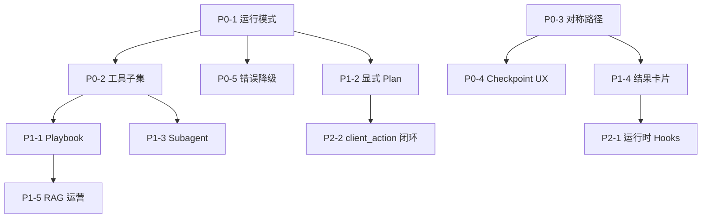

# Cursor Agent 对标分析与优化计划

> **文档性质**：迭代设想与对标分析，**不是**编码唯一依据。架构实现仍以 [`../architecture/`](../architecture/) 为准。  
> **目标**：借鉴 Cursor Agent Harness 的可靠智能设计，提升本仓（ims-ai-desktop）Agent 产品能力，**不**复刻 IDE 写代码能力。  
> **基线**：Desktop M1（聊天 + Plan 步骤条 + HITL）；验收见 [`../desktop-m1-acceptance.md`](../desktop-m1-acceptance.md)。  
> **撰写依据**：Cursor 公开文档（[Agent overview](https://cursor.com/docs/agent/overview)、Rules / Skills / Hooks / MCP / Subagents）+ 本仓 `docs/architecture/*`。

---

## 1. Cursor Agent 技术实现摘要

### 1.1 三要素（官方模型）

| 层               | 含义               | 典型内容                                    |
| ---------------- | ------------------ | ------------------------------------------- |
| **Instructions** | 行为约束与领域知识 | System prompt、Rules、`AGENTS.md`、用户偏好 |
| **Tools**        | 与外部世界交互     | 读写文件、Shell、Browser、Web、MCP          |
| **Model**        | 推理与工具选型     | 用户选定或 Auto 路由                        |

本质是 **Agent Harness（编排壳）**：模型决策，**工具在客户端/宿主确定性执行**，结果回灌后再决策——标准 tool-calling / ReAct 循环。

### 1.2 六层控制系统

| 层                    | 机制                                | 解决的问题                        |
| --------------------- | ----------------------------------- | --------------------------------- |
| 1 Context Engineering | Rules / Team Rules / `AGENTS.md`    | 短、硬约束常驻，防反复踩坑        |
| 2 Dynamic Knowledge   | Skills（按需）+ MCP + 代码索引      | 长流程与外部能力不占满 context    |
| 3 Mode / Permission   | Agent / Ask / Plan / Debug          | 用模式控制能力边界与流程          |
| 4 Tool Loop           | 搜 → 读 → 改 → 跑 → 验证            | 自主完成任务的主循环              |
| 5 Lifecycle Hooks     | beforeSubmit / preTool / afterEdit… | 审批、审计、格式化、拦截危险操作  |
| 6 Subagents           | Explore / Shell / Browser 等        | 重 context 任务隔离，摘要回主对话 |

### 1.3 用户需求处理流程（产品可见）

```text
用户输入 + 模式
  → 组装 Instructions（Rules / Skills / 会话上下文）
  → Hooks（beforeSubmit）
  → 模型推理：选工具 / 填参 / 或追问
  → Run Mode / 沙箱 / 审批
  → 执行 Tools / MCP / Subagent
  → 结果回灌 → 继续循环
  → 流式回复 + Checkpoint
  → afterResponse / stop Hooks
```

**模式差异**：

| 模式  | 行为                                              |
| ----- | ------------------------------------------------- |
| Agent | 可改文件、跑命令，完整工具循环                    |
| Ask   | 只读探索，不改文件                                |
| Plan  | 先研究与澄清 → 可编辑计划 → 用户 Build 后才写代码 |
| Debug | 先假设与运行时证据，再定点修复                    |

### 1.4 关键设计原则（可迁移）

1. **Instructions / Tools / Model 分离** —— 换模型不换架构
2. **工具确定性执行，模型只选型与填参** —— MCP 即为此
3. **短 Rules 常驻，长 Skills/文档按需加载** —— 控 context
4. **模式 = 权限 + 流程**，不是换一套编排引擎
5. **状态生命周期闭合** —— pending / streaming / interrupt 必须有 clear / finalize
6. **子任务隔离 context** —— 探索类工作不污染主对话

---

## 2. 本仓现状（对照基线）

### 2.1 已具备的同构能力（强项）

| Cursor 概念         | 本仓落点                                                              | 成熟度      |
| ------------------- | --------------------------------------------------------------------- | ----------- |
| Harness + Tool Loop | 父 `StateGraph` + 节点内 `create_agent`                               | ✅ M1       |
| Tools 单一执行面    | Platform MCP `:8010`；禁止业务 `@tool` 旁路                           | ✅          |
| 对话流协议          | FastAPI SSE `:8008`（与 MCP 分离）                                    | ✅          |
| HITL                | `interrupt` + `Command(resume)` + checkpointer                        | ✅          |
| 持久化              | `AsyncPostgresSaver` + `thread_id`                                    | ✅          |
| 知识增强            | Qdrant RAG + `retrieve_knowledge`                                     | ✅          |
| 契约单一源          | TS `packages/*` + Python `services/platform-contracts`（`contracts`） | ✅          |
| 工具执行边界        | MCP `runtime/tools`；Agent 禁止 `import platform_mcp`                 | ✅          |
| 质量门禁            | 对称路径、达梦只读、影响面清单                                        | ✅ 工程侧   |
| 对外 MCP            | Agent Gateway `/mcp`                                                  | ✅          |
| 开发态 Cursor 定制  | `.cursor/rules` / skills / hooks / mcp.json                           | ✅ 开发体验 |

### 2.2 产品定位差异（不要照搬）

| 维度          | Cursor                   | ims-ai-desktop                                   |
| ------------- | ------------------------ | ------------------------------------------------ |
| 用户          | 开发者                   | 平台运维 / 值班 / 业务用户                       |
| 主任务        | 读写代码、跑终端、改仓库 | 告警查询、设备操作、知识问答、页面跳转           |
| 危险面        | Shell / 任意文件写       | 平台写操作（经平台 API）、误操作设备             |
| UI            | IDE Agent 面板           | Electron AiAssistant（M1 无 BPMN 画布）          |
| Client Action | Browser / 编辑器         | `client_action`（navigate 等；无宿主可跳过降级） |

**结论**：对标的是 **可靠智能的 Agent 产品形态与工程方法**，不是 Cursor 的「AI 程序员」能力集。

---

## 3. 架构与实现差异对照

### 3.1 总览矩阵

| 能力域        | Cursor                          | 本仓现状                                         | 差距等级   | 说明                         |
| ------------- | ------------------------------- | ------------------------------------------------ | ---------- | ---------------------------- |
| 编排内核      | 闭源 Harness + tool loop        | LangGraph 父图 + `create_agent`                  | 低         | 路径正确，需打磨可靠性       |
| 工具面        | 内置 IDE tools + MCP            | **仅** Platform MCP + RAG 工具                   | 低（设计） | 业务侧应保持单一 MCP         |
| Instructions  | Rules 分层 + 智能应用           | System/节点 prompt + RAG；产品内无「用户 Rules」 | 中         | 缺可运营的场景 playbook      |
| Skills        | 按需加载多步骤工作流            | 开发侧有 skills；**运行时无对等物**              | 高         | 长流程易塞进大 prompt        |
| 模式系统      | Agent/Ask/Plan/Debug            | AI-first 默认恒 `react`；完整门控需关开关        | 高         | 缺用户可见的能力边界模式     |
| Context 管理  | 索引 + 按需读 + Skills 渐进披露 | 工具全量绑定 + RAG 注入                          | 高         | 工具一多易炸 context         |
| HITL / 审批   | Run Mode + Hooks + 确认         | interrupt 表单；高风险依赖 catalog/preflight     | 中         | 可产品化「运行模式」         |
| Subagents     | Explore/Shell 等隔离            | 基本单线程 `create_agent`                        | 中高       | 重检索/多步可拆子任务        |
| Checkpoint UX | 对话时间线可回滚文件            | checkpointer 可 resume；UX 偏弱                  | 中         | 用户难感知「卡在哪、能否续」 |
| 可观测性      | Trace/工具卡片较成熟            | SSE `trace` / tool 事件；卡片与运营不足          | 中         | roadmap 已列结构化卡片       |
| 并行 Agent    | Cloud / 多 Agent Window         | 单会话为主                                       | 低（M1）   | 可后置                       |
| Hooks 运行时  | 生命周期脚本可拦可改            | 开发 hooks ≠ 产品运行时钩子                      | 中         | 审计/拦截可标准化            |
| 模型路由      | Auto / 按任务复杂度路由         | 配置选定模型                                     | 低～中     | 可后置                       |

差距等级：**高** = 对「像 Cursor 一样可靠智能」影响大；**中** = 体验与稳健性；**低** = 可后置或已基本对齐。

### 3.2 架构层差异（设计）

```text
Cursor:
  Instructions(分层) + Mode(权限) + Tools(内置|MCP) + Subagents
       ↑ Hooks 贯穿
  Context: 索引 + 按需 Skills + 工具 schema 渐进

本仓:
  父图(classify→…) + create_agent(全量 MCP tools) + RAG
       ↑ HITL 仅 interrupt
  Context: 默认全量工具 + 每轮 RAG；AI-first 旁路 plan/device 门控
```

**设计债摘要**：

1. **AI-first 默认**提升「像通用 Agent」的灵活度，但弱化了 Plan/缺槽门控的可预期性（Cursor 用显式 Plan/Ask 模式补齐）。
2. **工具全量注入**与 Cursor「相关才详用」相反，扩展工具后可靠性会下降。
3. **场景 playbook（Skills 等价）未产品化**，复杂处置流程依赖模型临场发挥。
4. **模式对用户不可见**，无法表达「只查询 / 需确认才写 / 自由执行」。

### 3.3 实现层差异（工程）

| 主题        | Cursor 侧（公开行为） | 本仓实现                                  | 优化方向                        |
| ----------- | --------------------- | ----------------------------------------- | ------------------------------- |
| 工具发现    | MCP schema 按需       | 启动 `get_tools()` 全量绑定               | 意图/catalog 子集注入           |
| 确认门控    | Run Mode allowlist    | preflight + `hitl_required`               | 统一「会话运行模式」            |
| 计划        | Plan Mode + Build     | `plan` SSE + 步骤条；AI-first 下门控旁路  | 可选恢复显式 Plan 或 UI 开关    |
| 失败恢复    | Checkpoint / 重试     | resume/reject/abort 契约已有              | 加强 UI 状态机与残留清理验收    |
| 文档优先    | MCP docs / Skills     | 开发强制 docs-langchain                   | 运行时知识分片 + 工具说明书压缩 |
| 审计        | Hooks / 日志          | AuditLog 等桌面能力                       | 工具前后钩子标准化写入          |
| Client 执行 | Browser 工具闭环      | `client_action` 单向；无 tool-result 回调 | 有宿主时补执行回执（后置）      |

### 3.4 本仓已对齐、必须守住的红线

- 禁止图外 `pending_*` HITL、禁止 ReAct 双轨
- 禁止 Platform MCP 旁路业务 `@tool`；Agent **禁止** `import platform_mcp`
- 共享逻辑只依赖 `contracts`（目录 `services/platform-contracts`）
- 平台达梦仅 `SELECT`；业务写只经平台 API
- SSE 与 MCP 职责分离（MCP 不替代聊天流）
- M1 不引入 BPMN 编排画布

后续优化 **必须落在父图 / MCP / checkpointer / SSE 主链内**，与 [`ai-dev-quality-gates`](../../.cursor/rules/ai-dev-quality-gates.mdc) 一致。

---

## 4. 目标产品画像（对标后的「可靠智能」）

面向平台用户，Agent 应达到：

1. **可预期**：用户知道当前是只读、确认后执行、还是自主执行
2. **可控**：高风险写操作必经 HITL；reject/abort 后无残留 loading/Plan/interrupt
3. **省上下文**：工具与知识按需进入模型，长流程有 playbook
4. **可观察**：工具步骤、计划、中断原因、审计可回看
5. **可恢复**：同 thread 可 resume；新意图正确清理旧 interrupt
6. **可扩展**：新工具只走 catalog → export → MCP → preflight → i18n

**非目标**：IDE 级任意 Shell/改文件、Cloud 多 Agent 农场、BPMN 画布（除非单独立项）。

---

## 5. 后续优化计划

按「先可靠性与 context，再体验，再规模化」排序。每项标注建议落点与验收要点。

### 阶段 P0 — 可靠性基座（建议 1～2 个迭代）

> 目标：行为像「可控的 Cursor Agent」，而不是「偶尔聪明的聊天框」。

| ID   | 事项                                       | 落点                                                                  | 为何                             | 验收要点                                                       |
| ---- | ------------------------------------------ | --------------------------------------------------------------------- | -------------------------------- | -------------------------------------------------------------- |
| P0-1 | **会话运行模式**（只读 / 确认执行 / 自主） | 桌面端会话设置 + Agent 请求字段 + 工具包装器/preflight                | 对齐 Cursor Mode：权限即产品     | 只读下拒绝写类工具或强制降级提示；确认模式下写操作必 interrupt |
| P0-2 | **工具子集注入**                           | catalog 风险/领域标签 → `create_agent` 绑定时过滤或两段式（先选后详） | 对齐 context 渐进披露            | 工具数增长后 token/延迟可测下降；关键路径不丢工具              |
| P0-3 | **对称路径硬化**                           | chat / resume / reject / abort / 新消息                               | Cursor Checkpoint 思维：状态闭合 | 按 M1 验收 + 专门「残留态」用例：无旧 Plan/HITL/loading        |
| P0-4 | **HITL/Checkpoint UX**                     | 桌面：明确「等待确认 / 可续跑 / 已拒绝」                              | 用户理解中断与恢复               | 刷新或重进会话仍能正确展示 interrupt 态                        |
| P0-5 | **错误与降级话术统一**                     | SSE `error` + i18n + MCP 不可达策略                                   | 可靠感来自失败可解释             | MCP 挂时明确提示且不静默空转                                   |

### 阶段 P1 — 智能与流程（建议 2～3 个迭代）

> 目标：复杂任务不靠「临场发挥」，而靠可加载的工作流 + 更好的计划/检索。

| ID   | 事项                               | 落点                                                         | 为何                                 | 验收要点                                             |
| ---- | ---------------------------------- | ------------------------------------------------------------ | ------------------------------------ | ---------------------------------------------------- |
| P1-1 | **运行时 Playbook（Skills 等价）** | 知识库分片或 Agent 侧 playbook 目录；按意图检索注入          | 对齐 Cursor Skills                   | 「告警处置 / 批量导出」等多步任务步骤稳定可复现      |
| P1-2 | **显式 Plan 体验开关**             | UI 开关或非 AI-first 路径产品化；保留 interrupt plan_confirm | 对齐 Plan Mode                       | 用户可要求「先出计划再执行」；Build/确认后才调写工具 |
| P1-3 | **轻量 Subagent / 子任务**         | 父图并行节点或专用检索子调用，摘要回主 agent                 | 对齐 Subagents                       | 长检索不污染主对话；主回复仍连贯                     |
| P1-4 | **结构化工具结果卡片**             | 桌面高频工具卡片（告警表、设备列表等）                       | roadmap 已列；对齐 Cursor 工具可视化 | 关键工具结果可读、可点选进入 HITL                    |
| P1-5 | **RAG 可运营化**                   | 知识增删改查、同步可观测                                     | 智能依赖知识质量                     | 运营可更新 playbook/规程而不改代码                   |

### 阶段 P2 — 产品化与规模（后续）

| ID   | 事项                      | 落点                                | 说明                                |
| ---- | ------------------------- | ----------------------------------- | ----------------------------------- |
| P2-1 | 运行时 Hooks（审计/拦截） | 工具调用前后钩子 → Audit + 策略引擎 | 对齐 Cursor Hooks；不替代 interrupt |
| P2-2 | 有宿主 client_action 闭环 | navigate / 告警详情执行回执         | 桌面 ↔ 平台联动                     |
| P2-3 | 模型路由（成本/质量）     | 按意图选小/大模型                   | 对齐 Auto 路由思路；非必须          |
| P2-4 | 多会话并行 / 后台长任务   | Worker + 通知                       | 弱对标 Cloud Agents；按业务需要立项 |
| P2-5 | BPMN 编排 UI              | 单独立项                            | **不在**本对标默认范围              |

---

## 6. 建议实施顺序（依赖关系）



**原则**：先 P0（可控、不炸 context、状态不脏），再 P1（更聪明），最后 P2（规模与联动）。

---

## 7. 每阶段「像 Cursor」的成功标准

### P0 Done

- [ ] 用户可切换只读 / 确认 / 自主，且后端强制生效
- [ ] 默认绑定工具为子集或分级；全量工具不再是唯一策略
- [ ] reject / abort / 新消息后无 HITL、Plan、loading 残留
- [ ] interrupt 态在 UI 可解释、可续跑

### P1 Done

- [ ] 至少 2 个高频场景有可版本化 playbook，且任务成功率可测提升
- [ ] 用户可选「先计划后执行」
- [ ] 至少 3 类高频工具有结构化卡片
- [ ] 知识/playbook 更新可不发版或轻发版生效

### P2 Done（按立项裁剪）

- [ ] 工具调用审计完整可查
- [ ] 有宿主时关键 client_action 可验证执行
- [ ] （可选）按意图模型路由上线

---

## 8. 风险与约束

| 风险                                | 缓解                                              |
| ----------------------------------- | ------------------------------------------------- |
| 为「像 Cursor」引入第二套 HITL/编排 | 坚持 interrupt + 父图主链；Plan/模式只是门控与 UX |
| 工具子集误伤能力                    | catalog 标签 + 回退「相关领域全开」+ 评测集       |
| Playbook 变成第二 prompt 垃圾场     | 短索引 + 按需全文；与 Rules/Skills 同样的渐进披露 |
| AI-first 与显式 Plan 冲突           | 用**用户/会话开关**共存，而非再加图外状态机       |
| 范围膨胀到 BPMN/Cloud               | 保持本文非目标；另立项                            |

---

## 9. 与现有文档的关系

| 文档                                                                  | 关系                                                              |
| --------------------------------------------------------------------- | ----------------------------------------------------------------- |
| [`../architecture/00-overview.md`](../architecture/00-overview.md) 等 | **编码唯一依据**；本文件不得与之冲突                              |
| [`README.md`](./README.md)                                            | 迭代入口；本文件为其详细对标专项                                  |
| [`../desktop-m1-acceptance.md`](../desktop-m1-acceptance.md)          | P0 验收扩展源                                                     |
| `.cursor/rules/*`、`.cursor/skills/*`                                 | **开发态** Cursor 定制；运行时能力需在 Agent/桌面产品内重建等价物 |

---

## 10. 参考链接

- [Cursor Agent overview](https://cursor.com/docs/agent/overview)
- [Cursor Rules](https://cursor.com/docs/rules)
- [Cursor Skills](https://cursor.com/docs/skills)
- [Cursor Hooks](https://cursor.com/docs/hooks)
- [Cursor MCP](https://cursor.com/docs/mcp)
- [Cursor Subagents](https://cursor.com/docs/subagents)
- [Cursor Plan mode](https://cursor.com/docs/agent/plan-mode)
- 本仓架构：[`../architecture/03-agent-runtime.md`](../architecture/03-agent-runtime.md)、[`02-mcp-platform-server.md`](../architecture/02-mcp-platform-server.md)

---

## 修订记录

| 日期       | 说明                                              |
| ---------- | ------------------------------------------------- |
| 2026-07-31 | 初稿：Cursor 摘要、与本仓差异矩阵、P0–P2 优化计划 |
